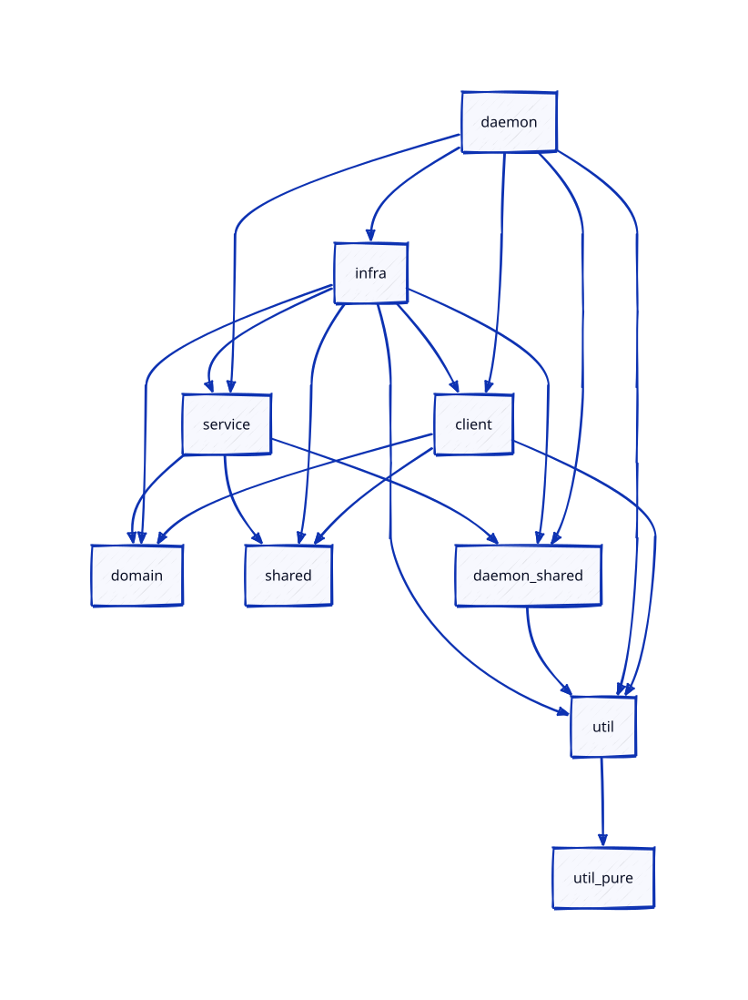
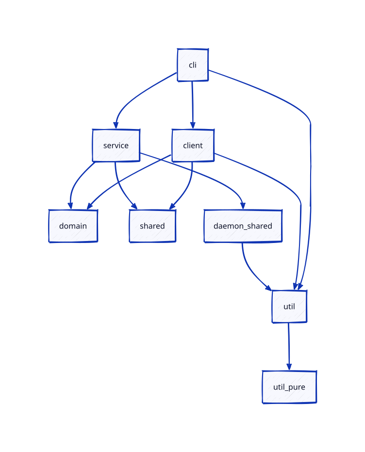

# Architecture Rules

## Overview

Operations Center uses a hexagonal layout using ports and adapters.
The call flow is:

* The client (CLI or UI) calls the REST API.
* The API calls a service.
* The service calls adapters and `repo` packages through ports.

A port is a Go interface that a service declares. An adapter implements it.
A `repo` package is an adapter that talks to the database or the file system.

Two lint runs enforce these rules:

* `go-arch-lint` checks which package may import which package. Its rules are
  in `.go-arch-lint.yml`.
* `depguard` and `forbidigo` (part of `golangci-lint`) check what a service may
  import or call. Their rules are in `.golangci.yml`.

Run both with `make lint`.

## Layers

* **Services** contain the business logic. A service is pure logic. It does
  not touch the file system, the network, the database or the OS.
  Logging is allowed.
* **Pure packages** are the services, `internal/domain` and `shared/api`. They
  follow the same I/O rules as the services.
* **Adapters and `repo` packages** do the I/O. They implement the ports that the
  services declare.
* **API** exposes the services over REST.
* **Client and CLI** use the REST API. They use types from `shared/api`.

## Architecture graphs

The graphs show the components and their allowed imports. An arrow from A to
B means that A may import B.

The daemon graph shows the components that the daemon uses:

The CLI graph shows the components that the CLI uses:

`go generate ./...` updates both graphs. The graphs use
`.go-arch-lint-overview_gen.yml`, which `generate-filtered-architecture-def`
creates from `.go-arch-lint.yml`.

## Where to put a type

| Package                              | Use for                                                                                 |
|--------------------------------------|-----------------------------------------------------------------------------------------|
| `shared/api`                         | Types, filters and validation of the REST API. The client, the CLI and the UI use them. |
| `internal/<service>/<name>_model.go` | Types that the business logic and the adapters use.                                     |
| `internal/domain`                    | Errors and helpers that more than one service uses.                                     |

A model may use types from `shared/api` to keep the code simple.
`shared/api` must not import service packages.

## Rules that the lint tools enforce

* Services do not import adapters, `repo` packages, the API or the client.
* Pure packages do not import `os`, `os/exec`, `os/signal`, `io/fs`,
  `io/ioutil`, `net/http`, `syscall`, `database/sql` or Incus client packages.
* Pure packages do not call functions that read files, open network
  connections, or load certificates from disk. They do not call `time.Sleep`.
* `shared/api` and `internal/domain` import no service or adapter packages.
* Adapters and `repo` packages do not import the API.
* `internal/domain` may import packages from the common components.

## Rules that the code review enforces

The lint tools do not check these rules. Follow them when you write code.

* Only the composition root (`internal/api/daemon.go`) wires adapters into
  services. The composition root is the code that creates and connects all
  parts at start.

## Known exceptions

The lint configuration lists these exceptions. The baseline entries in
`.golangci.yml` and the `TODO` comments in `.go-arch-lint.yml` mark the open
work. Remove an exception when its code is fixed.

* Some pure packages use `net/http`, `os` or `time.Sleep`. These should use
  ports or injected clocks.
* The Incus client is used by the cluster ports file. It should move behind an
  adapter.
* `internal/domain` classifies network errors with `syscall` error numbers.
  This is accepted.
* The daemon and the adapters reach the other cluster members through the
  client. This is accepted.
* Services may import packages from the common components. Some of them do file,
  database or OS work. The lint tools do not block this. Keep new code in these
  packages free of I/O where possible.

## Adding a new package

When you add a package, `go-arch-lint` fails until you add it to a component
in `.go-arch-lint.yml`. Pick the component that matches the package role.
